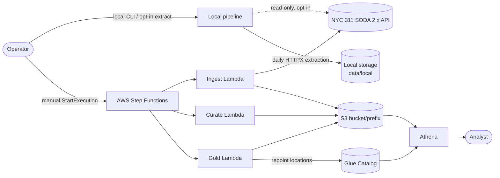
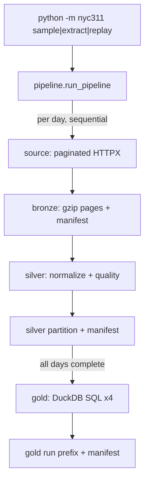
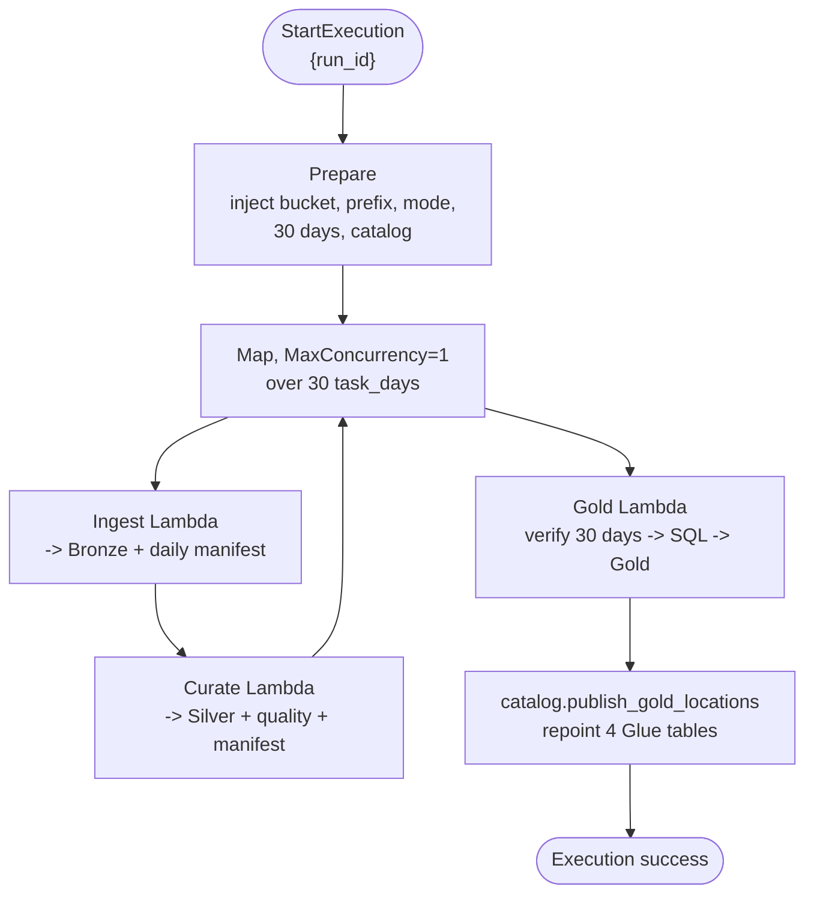

# Architecture

NYC 311 September 2026 is a bounded, manually operated batch pipeline. The same
Python business logic runs in two places: a local CLI and AWS Lambda, driven by
a Step Functions state machine. Neither path schedules anything or runs
continuously.

## Context



Both paths produce the same logical Silver and Gold data and quality decisions;
only the storage backend and invocation wrapper differ.

## Layers

```text
operator entry      cli.py / lambda_ingest.py / lambda_curate.py / lambda_gold.py
orchestration       pipeline.py (local) · AWS Step Functions (separate stages)
domain              source · bronze · silver · gold (SQL + PyArrow) · silver_contract
storage boundary    storage.py (local) · s3_store.py (S3) · *_store.py (manifests)
control metadata    manifests.py · source_contract.py · config.py · lambda_runtime.py
```

Business rules never import an AWS client. AWS clients are constructed only in
`lambda_common.py` at invocation time, or in explicitly simulated tests.

## Local Execution



`sample` uses an in-memory HTTPX mock transport and a separate `sample`
namespace. `extract --live` performs the real read-only extraction. `replay`
reprocesses explicitly selected complete Bronze manifests without an HTTP client.

## AWS Execution



- `MaxConcurrency=1` and no scheduler/retry orchestration: one manual execution
  at a time. Any unrecovered task failure fails the execution.
- Gold verifies full-month coverage and cross-day identifier uniqueness before
  publishing. A catalog failure leaves the execution unsuccessful while the
  published Gold artifacts and the previous table locations remain intact.
- Inputs/results carry only dates, keys, counts and statuses, well below the
  256 KiB Step Functions payload limit.

## Storage Layout

Objects live under a bucket/prefix + mode namespace (`<prefix>/published` for
AWS and the official local run, `<prefix>/sample` for fixtures):

```text
bronze/run=<source-run>/created_date=2026-09-DD/page-NNNN.json.gz
control/bronze/<source-run>/2026-09-DD.json
silver/created_date=2026-09-DD/part.parquet
control/silver/2026-09-DD.json
quarantine/run=<processing-run>/2026-09-DD.json.gz
quality/run=<processing-run>/2026-09-DD.json
gold/run=<publication-run>/<product>/part.parquet
control/gold/<publication-run>.json
control/runs/<processing-run>.json
```

Silver is partitioned by NYC-local `created_date` into 30 finite partitions.
Gold is small and deliberately unpartitioned; each run is isolated under
`run=<publication-run>` so the last successful publication stays identifiable.
Control, quarantine and quality keys are kept outside queryable table
locations.

## Catalog And Query Boundary

Athena reads the four Gold tables through Glue. Each Gold table location points
at exactly one published run's product directory, never at a parent that would
mix runs. The Silver table declares `created_date` only as a Hive partition key
because the Parquet file already carries a physical `created_date` column.

Terraform provisions only the bucket/prefix, three functions, the state machine,
the Glue database/tables/partitions and the Athena workgroup. See the
[deployment runbook](deployment.md) for the authorization boundary, and
[data-dictionary.md](data-dictionary.md) for field-level types.

## Operating Boundaries

- **Single writer.** One execution at a time; no reader consumes a run until its
  complete manifest and (for AWS) its catalog locations point at it.
- **No global transaction.** Silver replaces one day at a time and Gold
  publication is run-scoped; failures are recovered by manual retry/replay, not
  automatic rollback.
- **Authorization.** Local processing and offline tests need no AWS access. Every
  AWS read, change, deployment or invocation requires explicit operator
  authorization.
